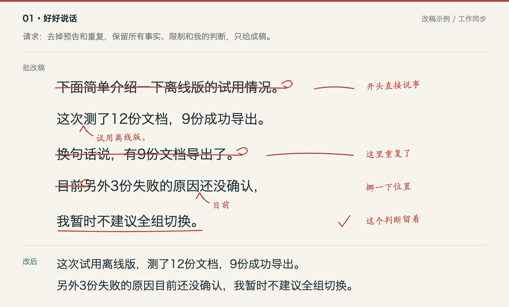

# 01.好好说话

中文表达 Skill，帮你写回复、按材料写稿、修改已有文字。保留事实和原意，按场景调整表达，不把所有稿子改成同一种口吻。

**调用名：`01-saywell`**

## 改稿示例



红笔标出删改，插入号标出补字或移入的位置，旁批说明改动原因；下方是完整改稿。示例材料为演示内容。

<details>
<summary>查看可复制的示例文字</summary>

**请求**：去掉预告和重复，保留所有事实、限制和我的判断，只给成稿。

**原稿**

> 下面简单介绍一下离线版的试用情况。这次测了12份文档，9份成功导出。换句话说，有9份文档导出了。目前另外3份失败的原因还没确认，我暂时不建议全组切换。

**改后**

> 这次试用离线版，测了12份文档，9份成功导出。另外3份失败的原因目前还没确认，我暂时不建议全组切换。

</details>

## 能做什么

- **改稿**：润色、去AI味、重写、审阅与前后对比，尊重指定的删改范围。
- **聊天代写**：根据对方的话、关系和你的来意，起草可发送的回复。
- **按材料写作**：起草介绍、通知、笔记；没有给的事实不补造。
- **简短答疑**：明确调用时，先答所问，不自动展开成完整教程。

“检测AI味”按表达审阅处理：定位重复、衔接、抽象总结或语气问题。它不鉴定作者身份、不提供AI含量，也不保证通过检测器。普通写作和问答不会仅因安装而自动套用；明确要求去AI味或点名调用时才使用。

## 安装

把这个 Skill 放进所用工具的技能目录，目录名必须是 `01-saywell`：

| 工具 | 目录 | 显式调用 |
|---|---|---|
| DeepSeek Harness（DSH） | `~/.agents/skills/01-saywell/` | `/01-saywell` |
| WorkBuddy | `~/.workbuddy/skills/01-saywell/` | `/01-saywell` |
| Codex | `~/.agents/skills/01-saywell/` | `$01-saywell` |
| Claude Code | `~/.claude/skills/01-saywell/` | `/01-saywell` |

**DSH 与 Codex 共用 `~/.agents/skills/`**，装一次两边都生效。

路径与调用方式参见[Codex文档](https://learn.chatgpt.com/docs/build-skills#where-codex-loads-local-skills)和[Claude Code文档](https://code.claude.com/docs/en/skills#choose-where-skills-load)。其他支持Agent Skills的工具按各自说明安装，未逐一验证。

从 [Releases](https://github.com/zane01Ai/01-saywell/releases) 下载 `01-saywell-x.x.x.zip`，解压到对应目录：

```bash
unzip "/下载路径/01-saywell-x.x.x.zip" -d "$HOME/.agents/skills/01-saywell"
```

其他工具把 `-d` 后面的路径换成上表对应的目录。升级时下载新版本，覆盖解压。

目标已存在时先检查已有安装，不要直接覆盖。**装完新开一个对话**，旧对话不会重新加载；是否需要重启取决于宿主。

不需要额外运行脚本或服务。模型账号与费用由所用工具决定。

### 让 AI 帮你装

如果用的是能读写文件和联网的编码工具（Codex、Claude Code 等），可以直接把下面这段发给它：

```text
帮我安装一个 Skill：
仓库 https://github.com/zane01Ai/01-saywell
从 releases 页下载最新的技能包，解压装到 ~/.agents/skills/01-saywell（DSH / Codex）
装完检查 SKILL.md 是否存在，并告诉我是否需要新开对话才生效
```

要装到 WorkBuddy 的话，再加一句：`另外在 ~/.workbuddy/skills/01-saywell 也放一份。`

**注意**：这是让 AI 执行通用的文件操作，不是 Skill 自带的能力。安装前建议先看一遍仓库内容，确认它只做「下载文件、放到指定目录」这件事——本 Skill 不需要运行任何脚本或服务。

## 用法

先完成上面的安装，再复制下面的调用示例。**只把调用名粘进聊天框，不会自动安装 Skill。**

下面统一用 `/01-saywell`（DSH、WorkBuddy、Claude Code 都一样）。Codex 把前缀换成 `$01-saywell`。

**改稿**

```text
/01-saywell 改下面这段，保留事实和数字，只给成稿。
【原稿】……
```

**聊天代写**

```text
/01-saywell 帮我回这句话：“项目又推迟了，白忙了两周。”
对方是同事，我想表示理解，不用给建议。
```

**按材料写**

```text
/01-saywell 根据下面材料写一段工具介绍，150字以内。
【材料】……
```

**只要建议**

```text
/01-saywell 只引用有问题的片段，解释阅读问题，不给替换全文。
【原文】……
```

改稿时先读懂整段意思，再灵活调整字句、顺序和段落，最后通读并核对事实、重点与语气。可以换一种更顺的说法，也可以保留本来就清楚的原句；不把“保留原意”变成逐字不动，不把“说人话”统一处理成口语化。更多边界见[使用说明](docs/01-好好说话-使用说明.md)。

把用途、原稿和需要保留的重点一起给它。改完后，核对数字、条件和承诺，再按自己的口气读一遍。

测试方法与记录见[验证说明](evals/VERIFICATION.md)。

## 常见问题

**这是提示词，还是需要安装的 Skill？**

本项目把中文写作要求整理成 Skill，安装到支持它的工具后，通过调用名使用。上面的示例是安装后的调用方法；把一句示例贴进普通聊天框，不等于加载了整套规则。

**需要开 Pro，或额外付费吗？**

本项目按 Apache-2.0 开源，不附带模型或订阅。是否需要付费账号、会产生多少模型费用，由你使用的工具和模型决定。

**能写英文吗？**

当前规则、示例和评测以中文为主，英文效果尚未专门验证。

**装了但调用不出来？**

按顺序查三处：

1. **目录对不对** —— DSH / Codex 看 `~/.agents/skills/01-saywell/SKILL.md`，WorkBuddy 看 `~/.workbuddy/skills/01-saywell/SKILL.md`，Claude Code 看 `~/.claude/skills/01-saywell/SKILL.md`。

   ```bash
   ls ~/.agents/skills/01-saywell/SKILL.md
   ```

   必须能看到 `SKILL.md`，且不要多套一层目录。
2. **是不是旧对话** —— 旧对话不会重新加载，要新开一个。
3. **前缀对不对** —— DSH / WorkBuddy / Claude Code 用 `/01-saywell`，Codex 用 `$01-saywell`。

都对还是不行，说明该宿主的技能发现机制与上表不同，请按其文档找技能目录。

## 目录

```text
01-saywell/
├── SKILL.md                 入口与任务分流
├── agents/
│   └── openai.yaml          界面描述
├── assets/readme/           README 示例图与可编辑 SVG
├── docs/                    使用说明
├── evals/                   固定回归、教学示例与评测记录
├── references/              按需读取的 4 份场景参考
├── scripts/validate.py      多宿主结构检查
├── tests/                   盲测工具的自测
├── LICENSE                  Apache-2.0
└── README.md
```

运行本地检查（Python 3，需要 PyYAML）：

```bash
# 结构与字段检查
python3 scripts/validate.py .

# 盲测工具的自测
python3 -m unittest discover -s tests -v
```

反馈问题时，请提供脱敏后的原稿、请求、实际输出和所用模型/工具。不要附上密钥、未授权的聊天记录或私人资料。

## 许可

本项目采用[Apache License 2.0](LICENSE)。
